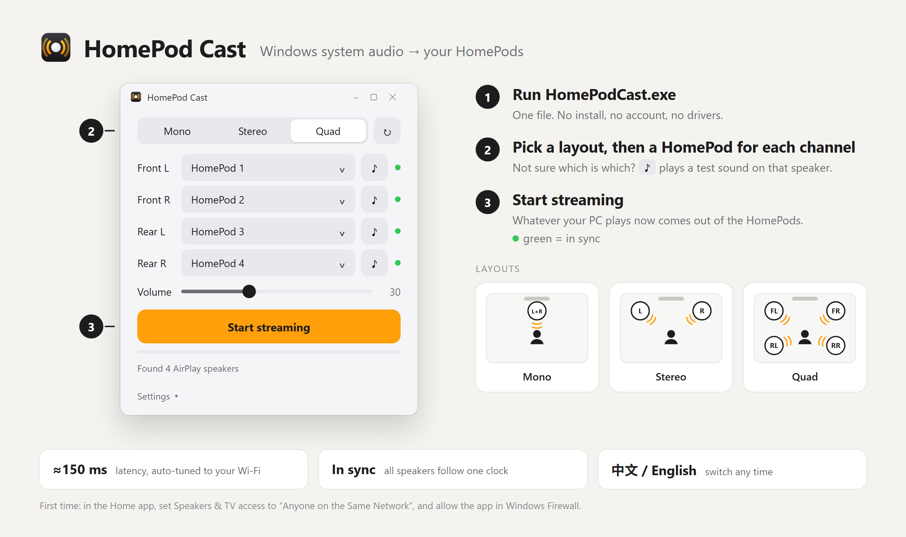
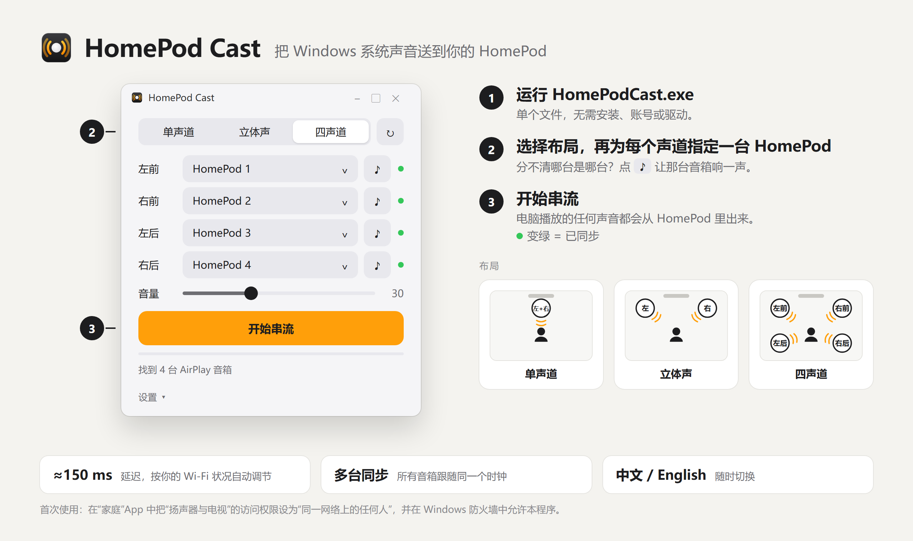

# HomePod Cast — Guide · 使用须知

[← Back to README](../README.md) · [English](#english) · [中文](#中文) · [Privacy · 隐私](#privacy--隐私) · [Build from source](#build-from-source)

---

## English



- **First run** — the exe is not code-signed, so Windows SmartScreen may ask: *More info → Run anyway*.
- **HomePod access** — Home app → Home Settings → Speakers & TV → *Anyone on the Same Network*, no password.
- **Firewall** — allow the app on private networks when Windows asks. A red dot means a HomePod cannot reach your PC.
- **Which speaker is which** — **♪** next to a channel plays a short test sound on that HomePod, before or while streaming.
- **Latency** — AirPlay needs a buffer. *Auto* keeps it as small as your Wi‑Fi allows, about 150 ms in total: fine for music and video, too slow for games.
- **Quad** — separate rear channels need a 5.1 or 7.1 Windows output device. With a stereo source the rear speakers repeat the front ones.
- **PC speakers** are muted while streaming and unmuted when it stops; *Mute* in Settings turns that off. A few output devices can only be muted by Windows, which would silence the stream too: those keep playing, so turn them down on the device itself. The Windows volume still changes what is streamed.
- **Dropouts** — a HomePod that loses the connection is reconnected on its own while the others keep playing. One that another device has started playing to is left alone until it is free. With *Dropout* switched off in Settings, the stream stops instead when a HomePod is lost.
- **Closing the window** hides it; the app keeps running, and streaming, as an icon in the notification area. Click the icon to get the window back, right-click it to quit. Starting the app a second time brings up the one that is running.
- **Settings** — source device, buffer (Auto or fixed), language (中文 / English) and *Startup*, which starts streaming with the last setup when you sign in to Windows, with only the icon showing. The window follows the Windows light or dark mode.
- **Updates** — at launch the app asks GitHub for the latest release and shows a link in Settings when there is a newer one. Nothing else is sent.
- Tested with HomePod mini on Windows 11.

---

## 中文



- **首次运行** — exe 没有代码签名，Windows SmartScreen 可能会拦截：*更多信息 → 仍要运行*。
- **HomePod 权限** — “家庭”App → 家庭设置 → 扬声器与电视 → *同一网络上的任何人*，不设密码。
- **防火墙** — Windows 询问时允许本程序使用专用网络。圆点变红表示 HomePod 连不回电脑。
- **分清每台音箱** — 声道旁的 **♪** 会让那台 HomePod 响一声测试音，串流前、串流中都能用。
- **延迟** — AirPlay 必须有缓冲。*自动*档会按 Wi‑Fi 状况把它压到最小，总延迟约 150 ms：听音乐、看视频没问题，不适合游戏。
- **四声道** — 独立的后置声道需要把 Windows 输出设备配置成 5.1 或 7.1。音源是立体声时，后置会重复前置。
- **电脑音箱**在串流时自动静音，停止后恢复；可在设置里关掉*静音*。少数输出设备只能由 Windows 代为静音，那样串流也会没声音：这类设备不会被静音，请在设备本身上调小。Windows 音量仍然会改变串流的音量。
- **断线** — 掉线的 HomePod 会自动重连，其余音箱照常播放。被其他设备占用的音箱不会被抢回来，空闲后才重连。在设置里关掉*断线*后，有音箱掉线时改为直接停止串流。
- **关闭窗口**只是把它收起来：程序留在任务栏通知区域（托盘）继续运行、继续串流。点图标恢复窗口，右键点图标退出。再次启动程序会直接调出正在运行的那一个。
- **设置** — 音源设备、缓冲（自动或固定）、语言（中文 / English）和*自启*：登录 Windows 后按上次的配置自动开始串流，只显示托盘图标。窗口跟随 Windows 的浅色或深色模式。
- **更新** — 启动时向 GitHub 查询最新版本，有新版时在设置里显示下载链接，不发送其他任何信息。
- 已在 Windows 11 上用 HomePod mini 测试。

---

## Privacy · 隐私

HomePod Cast collects nothing and has no account, analytics or telemetry. Your audio goes only to the speakers you pick, on your own network. The one connection it makes beyond that is a request to `api.github.com` at launch, to look up the number of the latest release; like any web request it shows GitHub your IP address.

HomePod Cast 不收集任何数据，没有账号、统计或遥测。音频只发送到你在局域网里选中的音箱。除此之外，它只在启动时向 `api.github.com` 发一次请求，查询最新版本号；和任何网络请求一样，GitHub 会看到你的 IP 地址。

---

## Build from source

Windows 10/11, Python 3.12.

```powershell
pip install -r requirements.txt
python app.py     # run
.\build.ps1       # build dist\HomePodCast.exe
```

`engine.py` captures, routes and streams; `app.py` is the window and `tray.py` its icon in the notification area. `--autostart` starts streaming with the last setup, `--minimized` starts with only that icon showing.

Releases are built by [GitHub Actions](../.github/workflows/build.yml), not on a developer's machine: set `VERSION` in `app.py`, push, then push the tag `v` + that version. The workflow builds the exe, stamps the version into it and attaches it to a draft release.

## Credits

Built on [pyatv](https://github.com/postlund/pyatv), [SoundCard](https://github.com/bastibe/SoundCard) and [CustomTkinter](https://github.com/TomSchimansky/CustomTkinter). Not affiliated with Apple; HomePod and AirPlay are trademarks of Apple Inc.
